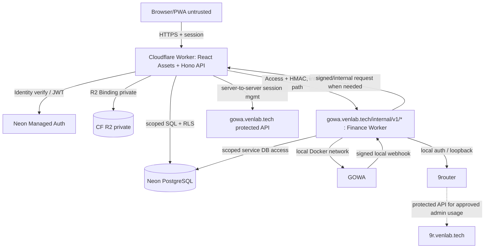

# TRD-00 — Arsitektur dan Kontrak Stack (LOCKED)

**Berdasarkan:** [`../docs/prd/PRD-00-INDEX.md`](../docs/prd/PRD-00-INDEX.md), [`../requirements/REQ-00-INDEX.md`](../requirements/REQ-00-INDEX.md). **Status:** keputusan arsitektur untuk target production; bukan bukti deployment berjalan.

## 1. Stack final, tidak boleh diubah diam-diam oleh coding agent

| Layer | Dipilih | Catatan / batas |
|---|---|---|
| UI | React + TypeScript + Vite | SPA mobile-first; bukan Next.js/SSR, tidak ada backend di browser |
| Routing & data | React Router + TanStack Query | Hierarki route dari desain; invalidasi cache sesudah mutation |
| Styling | Tailwind CSS + shadcn/ui primitives + design tokens | Visual harus mengikuti 180 PNG/manifest, bukan default shadcn |
| Grafik | Recharts dengan tabel tekstual ekuivalen | Semua chart data-driven, no screenshot chart |
| PWA/offline | vite-plugin-pwa/Workbox + Dexie/IndexedDB | Cache statis; offline queue data privat scoped perangkat+pengguna |
| Web+API | **1 Cloudflare Worker** melalui `@cloudflare/vite-plugin`, **Hono** | Frontend static assets + `/api/v1/*` same-origin |
| Database | Neon PostgreSQL Free | Satu project DB, schema multi-tenant; production migrations |
| Auth | Neon Managed Better Auth (`@neondatabase/auth`) | Email verification; protected session; OAuth optional; auth server bukan buatan sendiri |
| DB access | Neon serverless HTTP driver + Drizzle schema/migrations + Postgres RLS | RLS verified dengan Neon Auth identity; operasi uang menggunakan atomic DB function |
| Storage bukti | Cloudflare R2 **private Standard** melalui Worker binding | Object key namespace tenant, tidak pakai public bucket |
| Message gateway | GOWA (Go WhatsApp Web Multidevice) ARM64 di Armbian | REST/webhook v9-compatible; versi dibekukan setelah contract test |
| AI Gateway | 9router di Armbian | OpenAI-compatible & Anthropic-compatible adapters; **uji nyata vision** |
| Process service | Node.js 24 LTS TypeScript Finance Worker di Armbian | scheduler, webhook, AI/OCR, job recovery, queue, local GOWA access |
| OCR | Tesseract.js + Sharp di Armbian | Fallback saat Vision gagal/hasil ambigu, **bukan di Cloudflare Free CPU** |
| Network | Cloudflare Tunnel + Access service tokens | Hostname memisahkan fungsi; service-to-service only |
| Test | Vitest, Testing Library, Playwright, API contract & load tests | WA E2E real account gated/controlled, fake adapter in CI |
| IaC/deploy | Wrangler (web), Docker Compose (Armbian), migrations & GitHub Actions | Pin versions, staging branch, rollback, backup restore |
| Locale | IDR / Asia/Jakarta default, locale id-ID, en-US | multiuser dapat mengubah timezone & preferensi |

**Dependency version policy:** jangan gunakan `latest` di Docker/CI produksi. Catat versi persis paket dan image digest di lockfile, pin setelah pengujian, audit changelog sebelum upgrade; seluruh perintah adalah target, bukan bukti lingkungan sudah tersedia.

## 2. Trust boundaries dan diagram

**Penting:** browser hanya mengakses `finance.venlab.tech/api/v1`. **Tiga hostname** disepakati: `finance`, `gowa`, `9r`. Pada hostname GOWA, **rule Cloudflare Tunnel paling awal** untuk `^/internal/v1/` menuju Finance Worker (Access service token + HMAC + anti-replay), sedangkan path lain diarahkan ke GOWA yang juga diproteksi. Path-based ingress terbukti didukung dokumentasi Cloudflare namun konfigurasi Access dan path-normalization **wajib lulus tes P0**. Jangan menambah hostname keempat tanpa ADR atau mengekspos layanan karena routing gagal.

### Hostnames

| Hostname | Target | Publik/Access | Catatan |
|---|---|---|---|
| `finance.venlab.tech` | 1 CF Worker (SPA+API) | Publik; auth untuk privates | No additional api subdomain |
| `gowa.venlab.tech` | `/internal/v1/*` → Finance Worker; semua path lain → GOWA | **Access service identity per path + HMAC untuk worker** | Urutan rule internal dahulu; GOWA Basic Auth tetap aktif; jangan expose UI admin ke publik |
| `9r.venlab.tech` | 9router Armbian via CF Tunnel | **Access + gateway API key** | Finance Worker gunakan jaringan lokal, tidak perlu Internet loop |

Semua domain tetap di zone `venlab.tech` Cloudflare. Tidak ada kebutuhan subdomain terpisah untuk Neon atau R2 private.

## 3. Modularity / ownership

- `apps/web`: React SPA, locale, design system, cache API, browser offline + shared schemas.
- `apps/edge`: Hono routes, auth gate, RBAC, RLS-scoped DB functions, R2 access, bridge client; **tidak menjalankan WhatsApp socket/scheduler/OCR**.
- `apps/finance-worker`: Armbian Node long-running: GOWA webhook parsing, per-tenant routing, command parser, AI adapters, OCR + recheck, scheduler, outbox publisher, recovery.
- `packages/contracts`: Zod request/response, command/event schemas, error IDs, exact integer-money conventions; imported by web/edge/worker (browser imports only safe types/schema).
- `packages/domain`: pure financial invariants, classification hints, timezone/period logic, idempotency decisions; zero server secrets.
- `packages/ui`: brand components, tokens, accessibility conventions, no data access.
- `packages/db`: Drizzle migration definitions, PG functions, RLS policies; service-role usage restricted to migrations/offline ops.
- `infra/`: Wrangler, Docker Compose, Access documentation, startup/smoke/backup scripts. No secrets committed.

## 4. Kesepakatan konsistensi

- Satu posting uang harus **atomic** dan **idempotent**; tidak boleh menambah saldo sekali sebelum anggaran selesai ditulis.
- Client menghitung pratinjau lokal, namun angka terkonfirmasi dari server adalah authoritative. Cache invalidation dan optimistic UI berlabel jelas.
- Transaksi keuangan final immutable-by-event: edit/void membuat revision/reversal ter-audit, bukan kehilangan histori.
- Pending/provisional AI hanya *candidate*, belum posted di ledger; recheck tidak pernah membuat transaksi baru otomatis.
- WA webhook diproses paling tidak sekali dan di-dedup via `(source, device/session, message_id, owner)`; ACK hanya setelah durable inbox.
- Seluruh operasi penyimpanan melibatkan `user_id` yang diambil dari identitas server; browser-supplied tenant IDs diabaikan.
- Offline client queue memiliki `client_mutation_id` stable saat retry; server unique constraint.
- Worker tidak mengandalkan Cron Free tiap menit; notifikasi bridge + persistent job di DB + rekonsiliasi jarang, menghindari Neon kept-awake.

## 5. Rilis bukan MVP

Seluruh PRD harus selesai sebelum label production. Fase pada [`../plan/PLAN.md`](../plan/PLAN.md) adalah **urutan pengembangan**, bukan izin menghilangkan fitur. Uji beta privat dan peluncuran publik adalah gerbang yang berbeda.

## 6. Blocking assumptions

1. Neon Auth production email custom SMTP/approved mailer harus tersedia dan layak biaya; shared/default mailer belum bisa dianggap production deliverability. Jika tak bisa dicapai Rp0, blokir publik atau dokumentasikan biaya dan minta persetujuan.
2. GOWA adalah API tidak resmi, terkait risiko aturan WhatsApp. Personal accounts multiuser **feature-flag gated** hingga compliance/privacy/security/bench lulus; shared bot nonresmi juga berisiko.
3. Managed Neon Auth + Neon JWT RLS melalui driver HTTP harus dibuktikan dalam P0; jika driver tak sesuai, pindah hanya DB access adapter melalui ADR dengan perilaku RLS identik, bukan menonaktifkan RLS.
4. R2 Standard allowance dan total biaya tetap dipantau; bucket bukan egress publik. AI upstream gratis hanya jika router/provider user benar-benar gratis sesuai ketentuan mereka.
5. Tidak ada validasi nyata terhadap perangkat Armbian, DNS/Tunnel, akun CF, maupun 9router di sesi perencanaan ini. Test gate **belum** diluluskan.

**Selanjutnya:** [`TRD-01-DATA-MODEL.md`](./TRD-01-DATA-MODEL.md), [`TRD-02-API-CONTRACTS.md`](./TRD-02-API-CONTRACTS.md), [`TRD-03-INTEGRATIONS-JOBS.md`](./TRD-03-INTEGRATIONS-JOBS.md), [`TRD-04-SECURITY.md`](./TRD-04-SECURITY.md), [`TRD-05-DEPLOY-OPERATIONS.md`](./TRD-05-DEPLOY-OPERATIONS.md), [`TRD-06-TEST-STRATEGY.md`](./TRD-06-TEST-STRATEGY.md).
