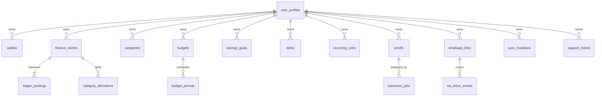

# TRD-01 — PostgreSQL Data Model, Ledger Invariants & RLS

**Scope:** schema logical yang harus diubah menjadi migration Drizzle/SQL eksplisit; nama final dan index boleh disesuaikan hanya lewat ADR serta tes migrasi. Data user = `user_id` Neon Auth subject (`text`), bukan UUID buatan klien.

## 1. Database boundaries

- `neon_auth.*`: **owned by Neon Managed Auth**, jangan mengubah migration auth internal; `user_id` dari subject verified. Buat `public.user_profiles` untuk preferensi/bisnis aplikasi.
- `public.*`: tenant-private tables, `user_id` non-null kecuali konfigurasi platform, RLS default-deny, bukan satu schema per user.
- `platform.*`: configuration, aggregated metrics, feature flags, admin actions; tidak berisi raw ledgers/chat. Role DB service internal terbatas.
- `audit.*`: audit append-only/redacted; separate read privilege. Data retention eksplisit.

## 2. Relasi inti

## 3. Table contract

**Kolom wajib bersama:** `id uuid` (server/generated), `user_id text`, `created_at timestamptz`, `updated_at timestamptz`, kecuali table system; setiap row private punya `user_id`. `deleted_at` hanya pada objek yang boleh soft-delete. All money `bigint *_minor`, currency `char(3)` default `IDR`. For API, `amountMinor` dikirim sebagai **decimal integer string**; display via locale helper, tidak pernah `Number` floating point untuk operasi finansial. Negative tidak valid sebagai input nominal, sign ditentukan oleh posting/kind.

| Table | Atribut/domain utama | Constraints / indexes |
|---|---|---|
| `user_profiles` | `user_id PK`, display_name, locale, timezone IANA, preferred_currency, account_status, onboarding_at, masked_numbers | user_id match verified auth; self-service only |
| `platform_roles` | `user_id PK`, role `user/admin/superuser`, assigned_by, version | hanya privileged role mutation; no public signup role |
| `wallets` | type `cash/bank/e_wallet/savings/other`, name, archived_at, currency, display_order | unique `(user_id, name)` active; archived wallets remain in history |
| `transaction_drafts` | owner, source `manual/wa_text/recurring/import`, payload (validated), state `draft/review/cancelled/confirmed`, based_on_version, idempotency_key, linked_event_id nullable | **non-posted** server drafts; unique owner + source key; confirm creates exactly one `finance_events` row; optional AI candidate reference is link-only |
| `finance_events` | kind `income/expense/transfer/refund/adjustment/debt_payment/debt_opening/loan_disbursement/loan_receipt/savings_transfer/opening`, effective_at, timezone, note, merchant, source_channel, client_mutation_id, status `posted/voided`, revision_of, reversal_of, receipt_no | unique `(user_id, source_channel, client_mutation_id)` where idempotent, `command_idempotency` canonical request hash; event immutable after post except controlled metadata |
| `ledger_accounts` | per-wallet asset accounts plus per-user contra accounts `income/expense/liability/receivable/equity` (receivable is debit-normal asset, liability credit-normal); `wallet_id NULL` for contra | unique per wallet and contra purpose; belong to same tenant |
| `ledger_postings` | `finance_event_id`, `ledger_account_id`, `signed_minor bigint`, `currency`, posted_at | foreign keys same user; sum postings = 0 for each event+currency enforced in atomic post command |
| `category_allocations` | `finance_event_id`, `category_id`, `amount_minor`, note | expense/refund/**debt_payment** envelope allocations sum eligible amount where categorized; positive stored magnitude with sign derived from `finance_events.kind`; **debt principal** reduces debt-budget envelope and cashflow, **not** consumption expense |
| `categories` | name, parent_id, icon_key, system_template_key, color_token, archived_at | no cross-owner parent links, history preserved |
| `budgets` | name, kind `category/global`, category_id optional, frequency `daily/weekly/monthly/custom`, rollover_policy, warning_thresholds | only tenant owner; global + category budgets distinct |
| `budget_periods` | budget_id, starts_on, ends_on, timezone, planned_minor, rollover_from_period, computed remaining view | unique `(budget_id,starts_on,ends_on)`; no overlaps unless explicit disjoint rules; no postings for mere budget movements |
| `budget_allocations` | from_period, to_period, amount_minor, reason, idempotency_key | reallocates **planned** amounts, not wallets; atomic total budget consistency |
| `savings_goals` | name, target_minor, target_date, target_wallet_id, status | progress calculated from explicit linked allocations/transfers, not raw wallet balance assumed |
| `goal_contributions` | goal_id, `finance_event_id`, amount_minor | avoid duplicate association; can reverse on void |
| `debts` | direction `owed_by_user/owed_to_user`, counterparty_label, principal_minor, opening_date, due_date, status, ledger_account_id | payable links credit-normal liability, receivable links debit-normal receivable; opening event establishes initial principal; outstanding calculated from immutable postings |
| `debt_payments` | debt_id, finance_event_id, principal_minor, memo | amount <= remaining or explicit overpayment flow |
| `recurring_rules` | kind, scheduled_at, timezone, frequency RRULE subset, amount_minor, next_due, requires_confirmation, reminder_options | schedule does **not** automatically post until user confirms; recurrence idempotent |
| `day_reports` | local_date, timezone, status `unreported/partial/done/zero`, checked_at | unique `(user_id, local_date)`; no-input ≠ zero |
| `proofs` | `object_key` private, sha256, content_type, size_bytes, expires_at, owner, consent_version, source, upload_status | unique `(user_id,sha256)` optionally linked to multiple candidates; R2 key never client-provided |
| `extraction_jobs` | proof_id nullable, source_text_ref, state, provider_adapter, retry_after, attempts, error_code, lock_owner, lock_until, consent_snapshot, output_version | unique event/link idempotency; indices state+retry_after and owner |
| `extraction_candidates` | job_id, source `vision/ocr/manual`, amount_minor nullable, kind/category/date/merchant, field_evidence, confidence_label, status `provisional/review/verified/rejected` | distinct from finance posted events; no direct silent mutation |
| `candidate_reviews` | candidate_id, reviewer_user_id, decision, before/after serialized redacted, reason, decided_at | only owner decision can confirm financial amount; audit linked |
| `duplicate_links` | canonical_event_id, suspected_candidate_id/event_id, proof_id, resolution | avoid false auto-merges; explicit user resolution for ambiguous matches |
| `sync_mutations` | client_mutation_id, device_install_id, entity, desired_action, based_on_version, state, result_ref, last_error | unique `(user_id, client_mutation_id)`; conflict returned to user, not lost |
| `command_idempotency` | user_id, operation, idempotency_key, request_hash, state, result_ref, expires_at | unique `(user_id, operation, idempotency_key)`; SAME key+different hash → 409, completed replay returns original result atomically |
| `whatsapp_links` | mode `shared_bot/personal_session`, `sender_jid_hmac`, `recipient_jid_ciphertext` (for shared-bot outbound), display_mask, GOWA `device_id` encrypted/opaque ref, state, opt_in, consent_version, last_health_at | unique active ownership by device/JID HMAC; sendable JID is encrypted at rest and decryptable only by authorized Finance Worker for opted-in messages; no bare hash reversal or unverified sender→user mapping |
| `wa_inbox_events` | link_id, source_device_id, message_id, event_kind, sender_jid_hmac, received_at, delivery_attempts, processed_at, hash, state | unique `(source_device_id,message_id,event_kind)` for dedup; never store whole chat by default |
| `reminder_preferences` | user_id, timezone, time_local, channels, quiet_start/quiet_end, paused_until, opt_in | one policy per channel; security message distinct |
| `reminder_deliveries` | user_id, local_date, kind, channel, idempotency_key, attempted_at, delivery_status | unique key; no duplicate across worker restarts |
| `consents` | user_id, purpose `AI_PROCESSING/AI_IMAGE/WA_SHARED/WA_PERSONAL/WA_CHAT_SCOPE/NOTIFICATIONS/SUPPORT_ACCESS`, policy_version, granted_at, revoked_at | active consent required every processing stage, not only snapshot |
| `support_tickets` | ticket_id, category, priority, status, description_redacted, requester_id | support content minimal; own data only |
| `support_access_grants` | ticket_id, scope manifest, expires_at, revoked_at, granted_by | least data scope; Admin cannot open unless active permission |
| `data_requests` | kind `export/delete`, state, initiated_at, verified_at, completed_at, object_key nullable, error_code | user only; system metadata only; download limited-time |
| `platform.feature_flags` | key, targeting, enabled, version, owner, updated_at | audit, rollback; personal WA and AI opt-in gated |
| `platform.quotas_usage` | user id/period/feature, consumed, limit, reset_at | atomic increment, no WA/API/AI runaway |
| `platform.integration_health` | service, status, checked_at, metadata redacted | no credential/PII in status |
| `audit.security_events` | subject, actor, action, resource_type, masked_id, result, reason_code, timestamp, trace_id | append only; no raw transaction/OTP/image payload |
| `platform.outbox` | aggregate_id, event_type, payload_ref, target, state, attempts, next_try, lock_until | durable message delivery for worker/notification |

## 4. Ledger math — benar sebelum cepat

Akun debit/kredit dikodekan sebagai signed posting dengan total **nol** per event per currency. Contoh:

| Event | Posting 1 | Posting 2 | Total |
|---|---:|---:|---:|
| Opening Tunai Rp100k | Asset Tunai +100k | Equity −100k | 0 |
| Expense Lauk Rp10k | Asset Tunai −10k | Expense Contra +10k | 0 |
| Income Rp1.2jt | Asset Bank +1.2jt | Income Contra −1.2jt | 0 |
| Transfer Tunai → Bank Rp50k | Asset Tunai −50k | Asset Bank +50k | 0 |
| Pembukaan utang lama Rp300k | Equity +300k | Liability −300k | 0 |
| Pembayaran pokok utang Rp100k | Asset Bank −100k | Liability +100k | 0 |
| Pembukaan piutang lama Rp300k | Receivable +300k | Equity −300k | 0 |
| Terima pembayaran piutang Rp100k | Asset Bank +100k | Receivable −100k | 0 |
| Refund Rp8k | Asset asal +8k | Expense Contra −8k | 0 |

- Saldo setiap dompet = sum postings pada `ledger_account` asset dompet, **bukan** jumlah anggaran.
- Expenses laporan = net expense events/category allocations within period, refund mengurangi secara eksplisit.
- `debt_payment` mengurangi *liability*; menerima pembayaran piutang mengurangi receivable. **Pembuatan utang/piutang wajib menimbulkan opening event** atau loan event yang seimbang; jangan membuat angka pokok hanya sebagai field yang tidak cocok dengan ledger. Contoh: pinjam uang baru Bank +X / Liability −X; pinjamkan uang Bank −X / Receivable +X; utang lama Liability −X / Equity +X; piutang lama Receivable +X / Equity −X.
- Pelunasan **pokok** utang/piutang bukan expense/income konsumsi. Jika user menyiapkan kategori anggaran Cicilan, pembayaran pokok utang **mengurangi envelope Cicilan dan kas tersedia** (cashflow), tetapi tetap **dikecualikan dari total konsumsi/P&L**. Bunga/biaya dapat berupa expense tersendiri. Jangan menambahkan expense pokok kedua.
- Budget used = posted net `expense/refund` allocations untuk envelope konsumsi **ditambah posted `debt_payment` pokok untuk envelope Cicilan jika user menganggarkannya**, dalam interval tanggal efektif lokal. Konsumsi expense tetap menghitung expense/refund saja. Transfer ke tabungan **bukan** expense atau `budget used` konsumsi; rencana menyisihkan tabungan ditampilkan sebagai *reserved planned allocation*, setoran aktual dari `goal_contributions`. Tidak boleh menjumlahkan angka consumption dan cashflow seolah metrik yang sama.
- Reversal event mengimbangi postings event asal dengan signed reverse; `void` + restore menghasilkan jejak, tidak memutasi saldo pembuka diam-diam.
- **Aturan kalkulasi void/restore:** postings milik event asal tetap disimpan dan tetap masuk sum ledger historis; `void` mengubah status/visibilitas bisnis dan membuat **satu** event reversal ber-postings kebalikan. Saldo/agregasi menghitung pasangan original + reversal yang saling meniadakan, bukan menghilangkan original sekaligus menguranginya lagi lewat reversal. `restore` menambah event compensating baru yang membalik reversal sebelumnya satu kali (idempotent). UI dan export harus membedakan status historis dari efek net saat ini.
- Finance SQL command **transaction-atomic**. Idempotency key and normalized request hash checked/written in the **same transaction** as event/posting; replay returns original committed result, conflicting payload returns HTTP 409. Do not implement as a separate check-then-write race. Race penarikan/transfers diuji dengan permintaan paralel; saldo negatif mengikuti konfirmasi eksplisit dan policy.
- `provisional/AI candidate` dan `transaction_drafts` tidak punya ledger postings sampai disahkan; status tidak bisa diubah ke `posted` hanya dengan mengganti label UI. **State kanonik:** `LOCAL_DRAFT` di IndexedDB; `SYNCING` pada sync queue client; `SERVER_DRAFT` pada `transaction_drafts`; `CANDIDATE_PROVISIONAL`/`NEEDS_REVIEW` pada `extraction_candidates`; `POSTED`/`VOIDED` pada `finance_events`. Restore/undo menghasilkan **event koreksi/reversal baru**, bukan `finance_events.status=restored`.

## 5. RLS & least privilege (HARUS)

- Tables tenant memakai PostgreSQL `ENABLE ROW LEVEL SECURITY` dan `FORCE ROW LEVEL SECURITY` di mana kompatibel; **default deny** untuk SELECT/INSERT/UPDATE/DELETE tanpa trusted authenticated subject.
- Kebijakan: `user_id = auth.user_id()` (fungsi/namespace sesuai skema Neon Auth yang diverifikasi pada P0) dan `WITH CHECK` untuk tulis. Referensi `wallet_id`, `category_id`, `proof_id`, dll. juga diperiksa **same-tenant** melalui constraints/procedure.
- Hanya `platform_roles` dan audit system memiliki privileged mutation APIs, tidak melalui ordinary authenticated user's DB policy.
- App runtime DB principal tidak memakai migrator/superuser role. Jangan menggantungkan keamanan hanya pada `WHERE user_id = ...` kode aplikasi; gunakan RLS sebagai pertahanan kedua.
- Service Worker Armbian uses **scoped internal credential** and stored procedures allowing specific tasks only, bukan database owner umum. Semua hasil tetap diikat ke owner asli setelah verifikasi event.
- Unit/e2e: A query object B, orphan FK cross-tenant, infer by 404/403, public file URL, stale Access tokens, admin session; default fail closed.

## 6. Index & data retention

- Tenant tables composite indexes `(user_id, effective_at DESC)`, `(user_id, status, created_at)`, `(user_id, category_id, effective_at)` sesuai queries.
- Wa Inbox/retry/outbox unique idempotency and `next_try` indexing; avoid full scan at high concurrency.
- Media blob original may expire after policy-defined number of days **set via admin with user disclosure**; default working proposal 90 days after final confirmation (DEC-010; subject to privacy approval) unless user chooses longer within quotas. **Do not hard-code into privacy notice before approval**.
- Auth/session security logs retention separate from app proof retention; legal/operational obligations evaluated before deletion; backups expire per reviewed restoration policy.
- No real user seed: fixtures `Mahasiswa Kos 1.2jt/200k` are synthetic examples and demo should label 'Contoh', not installed default for every user.

## 7. Migration and restore

- Migration forward-only, reversible where safe. Include pre/post counts and integrity assertions for each schema change.
- No manual PR migration on production through frontend. Separate migration principal, verified branch, backup/rehearsal then promote release.
- Additive migrations (`expand/contract`) for zero/low downtime; release can roll back application without dropping new columns.
- Restore test isolated, timebound, redacted report; *backup exists* ≠ *restore works*.
