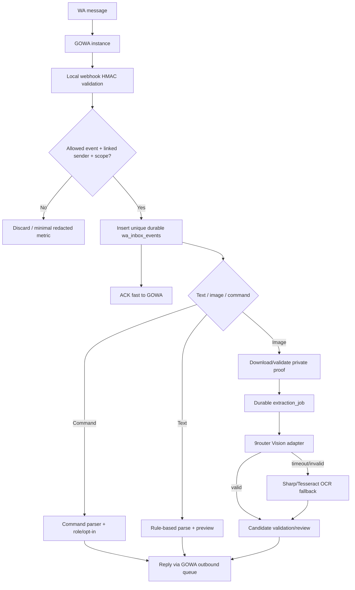

# TRD-03 — GOWA, 9router, Finance Worker, Queue & State Machines

**Scope:** asynchronous processing architecture on Armbian, not Vercel/Cloudflare long-lived background CPU. PRD source [`PRD-05`](../docs/prd/PRD-05-WHATSAPP-GOWA.md), [`PRD-06`](../docs/prd/PRD-06-AI-OCR.md).

## 1. GOWA adapter v9 capability contract

Official API (verify pinned installed version rather than trusting `main`): https://github.com/aldinokemal/go-whatsapp-web-multidevice/blob/main/docs/openapi.yaml and webhook schema https://github.com/aldinokemal/go-whatsapp-web-multidevice/blob/main/docs/webhook-payload.md

| User capability | GOWA adapter call | Security/edge response |
|---|---|---|
| Create personal slot | `POST /devices` | server generates opaque slot ID; store owner↔slot mapping; quota before create |
| Retrieve slot status | `GET /devices/{device_id}/status` | owner only, normalized enum; do not display list of other devices |
| Start QR login | `GET /devices/{device_id}/login` | ephemeral no-cache result, TTL/refetch |
| Start pairing code | `POST /devices/{device_id}/login/code` | entered phone format checked; number ownership **not yet proven** until the connected device identity is verified; no log of code, TTL |
| Reconnect | `POST /devices/{device_id}/reconnect` | only on appropriate disconnect states, rate-limited |
| Logout | `POST /devices/{device_id}/logout` | unpair WhatsApp, retain slot; stop notifications |
| Delete slot | `DELETE /devices/{device_id}` | destructive; double confirm/step-up; ledger unchanged |
| Set per-device webhook | `PATCH /devices/{device_id}/webhook` (verify exact path in pinned OpenAPI) | local HTTPS/loopback only, HMAC secret, filter message event |
| Send text/media | Versioned `/send/*` endpoints per pinned OpenAPI | selected verified `X-Device-Id`, approved content, idempotent queue |

**Do not expose `X-Device-Id` or GOWA Basic Auth from frontend.** Device may default to first slot when header omitted: integration must **always** send explicit device scope. Disable unused MCP/remote UI endpoints if not required. Never send Basic Auth in browser URL/WebSocket query even though GOWA supports a remote UI pattern.

### Shared bot versus personal sessions

- **Shared:** one operator-owned GOWA session; user links their number through a short code, private 1:1 conversation only. Mapping `(verified sender JID, user_id, link_id)` unique and revocable; store a keyed HMAC digest for inbound lookup **plus encrypted recipient JID** (or equally protected recipient reference) for actual outbound sending. A non-reversible hash alone cannot be used to address WhatsApp messages. Default mode if WA enabled.
- **Personal:** optional GOWA slot **per user** (one active slot at baseline), pairing code first on a single phone; QR available on second device. App only processes opted-in message scope, but **GOWA as a linked device can technically receive/store wider chat data locally**. UI/consent must disclose the third-party linked-device nature; GOWA local retention/access security must be reviewed. Never promise the WhatsApp provider cannot see chats or that session integration is official.
- Shared bot session may be paused/disabled globally by Superuser; disable per-user reminders on STOP, maintain separate security notices.
- No automatic unsolicited invites or bulk notifications. Respect WhatsApp policy and admin emergency stop.

## 2. Incoming WhatsApp event pipeline



**ACK rule:** HMAC verified and inbox persisted = ACK. No media download, Vision call or AI parse inside synchronous GOWA webhook. If DB unavailable, return appropriate retryable failure, record bounded local spool encrypted on Armbian if needed, replay with same unique key.

**Event whitelist:** `message` event type, 1:1 link membership, text/image/document with allowed MIME; group/newsletters/status/reactions/presence/calls discarded by default. Ignore own outgoing messages to prevent loops. WhatsApp identity may change (JID/LID): normalize/verify sender and prevent raw string spoof. Do not log raw messages.

## 3. Personal session state machine

```text
NOT_LINKED → SLOT_CREATED → PAIRING_PENDING ─→ CONNECTED
                           ├→ PAIRING_EXPIRED → PAIRING_PENDING (new code)
                           └→ ERROR
CONNECTED → DISCONNECTED → RECONNECTING → CONNECTED
            └→ NEEDS_REPAIR → PAIRING_PENDING
CONNECTED/DISCONNECTED → LOGGED_OUT (slot retained)
ANY SLOT STATE → DELETING → DELETED
```

- `CONNECTED` only after confirmed GOWA state. UI display may lag; never assume successful click means connected.
- `LOGGED_OUT` not `DELETED`. Delete slot does **not** touch ledger, consent audit or previous transactions. A pairing-code request **does not prove phone ownership**; only a confirmed linked-device connection whose resolved identity matches the intended user can set `CONNECTED` and active ownership.
- Link attempts rate-limited, expired QR/pairing code replaced via active user action.
- A disconnected personal session must not silently fall back to another user's session.

## 4. AI/Receipt pipeline

- **Provider abstraction:** `extractImage(proof, modelCapability)` and `parseText(input)` use provider OpenAI-compatible or Anthropic-compatible shapes **independently**. Do not hardcode `gpt-4o`, Claude model IDs, or 9router channel names in source. Service config provides model id, provider, endpoint, auth secret, capability flag (`vision=true` verified), maxTokens, timeout, retries, cost constraints.
- **9router local access:** Finance Worker connects to `http://9router:<internalport>` over private Docker network with gateway API key. `9r.venlab.tech` protected via Tunnel is external administrative endpoint; avoid request leaving and re-entering home network.
- **Image payload:** require true image content to reach selected model; smoke test with explicit controlled receipt and with `image_url`/image blocks. A text-only response that hallucinates nominal is `VISION_UNSUPPORTED`, must fail closed to OCR.
- **Input sanitization:** images are untrusted evidence, not system instructions. Resize/rotate/strip EXIF as policy, limit dimensions/bytes, avoid remote image URL fetching by arbitrary users (SSRF); provide bytes/object from private storage.
- **Output validation:** structured schema (`amountMinor` decimal string or null; currency; transactionKind enum; effectiveAt nullable; merchant nullable; category suggestion nullable; fields provenance). Reject extra tools/URL requests, absent original evidence, 0/negative ambiguous amounts.
- **OCR fallback:** Tesseract.js local worker with Sharp enhancements (one controlled resize/contrast path), parse currency separators `10.000`, `10,000`, `Rp 10.000`; ambiguity → review, not automatic posting.
- **AI recheck:** jobs tagged `recheck_required`; retry after AI health restored with circuit breaker; same `proof_id`, same `candidate_id` lineage; if match enrich confidence/evidence, if mismatch produce conflict requiring owner review; final ledger immutable.
- **Privacy:** verify active AI consent before every outbound request. Revoke consent: cancel queued unsent tasks and mark race outcome. Store minimal provider name/tokens/cost metrics, no raw prompt containing PII in logs.

### Extraction lifecycle

```text
UPLOADED → QUEUED → PROCESSING_VISION → CANDIDATE_READY → USER_REVIEW → POSTED
                      ├→ OCR_FALLBACK → PROVISIONAL → RECHECK_QUEUED → RECHECKING
                      │                                        ├→ VERIFIED_CANDIDATE
                      │                                        └→ CONFLICT → USER_REVIEW
                      ├→ FAILED_RETRYABLE → QUEUED (bounded retries)
                      └→ FAILED_PERMANENT → MANUAL_REQUIRED
ANY NON-POSTED → CANCELLED/EXPIRED (privacy/retention)
```

Labels `PROVISIONAL`, `USER_REVIEW`, `CONFLICT` pada diagram adalah **workflow/UX aliases** yang diproyeksikan ke `extraction_candidates`/`candidate_reviews`: contoh `PROVISIONAL` = UI `CANDIDATE_PROVISIONAL` dan `USER_REVIEW` = UI `NEEDS_REVIEW`; itu **bukan enum tunggal tabel `extraction_jobs`**. `POSTED` on this end-user diagram is a **composite display state** reflecting linked `finance_events.status=posted`, not a new `extraction_jobs` state. Extraction job completes with `linked_event_id` and immutable candidate history; finance event is created only once after required confirmation. Recheck cannot mutate any existing posted event.

## 5. Durable job dispatch / Neon sleep optimization

**Write first, notify second:** PWA uploads/creates job through Cloudflare Worker → Neon durable `extraction_jobs` + `platform.outbox` (in same transaction) → Worker sends signed notification to `gowa.venlab.tech/internal/v1/jobs/notify` (best effort; tunnel ingress path → Finance Worker). If Tunnel down, job remains pending.

**Armbian Finance Worker:** accepts notify, confirms job exists in DB, leases job (`lock_until`, attempt count), processes, commits result & outbox reply; records heartbeat; on startup drains unfinished leases. A reconciliation sweep runs low-frequency (default **every 30 minutes**) in the background, plus demand triggered notifications. Avoid polling Neon every few seconds (free compute & scale-to-zero).

- Job lease and unique idempotency permit at-least-once delivery with exactly-once **financial effect**.
- Retries jittered exponential backoff and max 5 normal attempts; HTTP 429 honor Retry-After; permanent schema/consent errors not hammered.
- Circuit breaker provider health: threshold 3 failures/2 minutes (tunable), half-open probes, separate rate limits per model and per tenant.
- Processing/queue SLA reported as **observed**, not promised under free tiers; if Armbian down for hours, UI says waiting.
- Never process the same job in edge and Armbian concurrently without a shared lock/lease.

## 6. Reminder & natural language message contract

- Default example: daily 20.30 user timezone, configurable. Finance Worker schedules via per-user `reminder_preferences`. Source of day status is `day_reports`, not absence of recorded expense alone.
- If user already completed, no reminder. If partial, ask if more. Unreported: ask total; zero only after explicit `nihil`.
- Commands: `saldo`, `budget`, `hari ini`, `minggu ini`, `bantuan`, `batal`, `nihil`, `selesai`, `STOP`, `MULAI`. Ignore unrecognized content safely and ask clarification, no arbitrary user-provided text as tool command.
- Send output minimal by default: e.g. "Makan Rp10.000 tercatat; jatah Makan Rp20.000", with hide amount opt-in honored. No contact group broadcast.
- Per user quota and per instance outbound cap; delivery ledger unique `(user_id, date, reminder_type, channel)`; missed reminders not burst-spammed on restart.
- Disable promotional or punitive language; no user shame for overspend.

## 7. Cloudflare limits remain separated

Cloudflare Worker only validates, signs, authorizes, fetches/stores R2 metadata, updates Neon, and calls bridge. **Do not** run OCR, Sharp heavy transforms, long chat connections or cron loops inside Workers Free (10ms CPU/request target). Most heavy work on user-owned Armbian.

## 8. Adapter testing requirements

1. Unit with fake GOWA/9router: retry, reconnect, webhook replay, invalid signature, wrong sender, idempotency, QR expiry.
2. Contract against pinned `docs/openapi.yaml` and version endpoint (`/app/info` if exposed) prior to release.
3. Vision fixtures: clear/blurred, multiple totals, QR-with-no-amount, receipt cross-provider, JPEG/PNG/WebP/PDF policy, bogus extra text instructions.
4. Multiuser concurrency: 2+ personal sessions plus shared bot; restart of one session must not force cross-tenant mapping even if upstream process restarts.
5. Hardware bench actual Armbian memory/CPU/IO: number of sessions and OCR concurrency determined by measured resources, not estimate.
